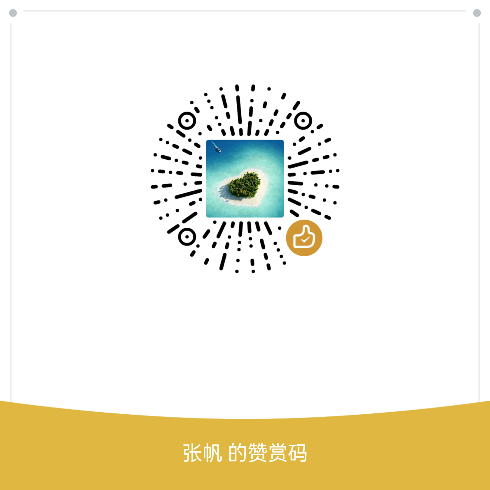

# 农场提醒 (Farm Reminder)

> 🍃 **轻量辅助 · 纯本地离线 · 零数据上传 · 绝无封号风险**  
> 专为微信小程序《QQ经典农场》打造的作物成熟提醒工具。

---

## 🛡️ 安全与隐私声明（为什么完全不用担心封号与泄密？）

本应用遵循**“轻量辅助、极简安全”**原则，与市面上的外挂脚本有着本质区别：

| 关注维度 | 本应用做法 | 传统外挂 / 脚本 |
| :--- | :--- | :--- |
| **封号风险** | **零风险**。纯屏幕文字只读识别，**不模拟点击、不自动收菜、不注入游戏代码、不拦截网络**，完全由玩家手动收菜，符合公平游戏原则。 | 模拟点击、代收代偷、内存注入、协议挂机，极易触发官方行为风控导致封号。 |
| **数据隐私** | **零上传**。内置 Google ML Kit 离线文字识别引擎，**无网络权限声明、无任何联网上报接口、无第三方统计 SDK**。所有截图与记录仅保存在本机私有沙盒。 | 需登录第三方账号、上传截图至云端服务器或收集设备信息。 |
| **系统占用** | **极轻量**。专注“看倒计时并定闹钟”这一件事，识别完毕即时释放计算资源，不常驻多余后台服务，低功耗省电。 | 臃肿庞大，长期占用无障碍全量监听或常驻悬浮窗吃运存。 |

---

## 🌟 核心特性

- 🔒 **100% 纯本地离线，绝无数据上传**  
  设备端侧完成全部 OCR 运算，无需连网，甚至可以在飞行模式下稳定工作；截图与日程绝不离开你的手机。
- 🛡️ **纯粹辅助定位，绝无封号风险**  
  如同为你配了一个“自动看时间并定闹钟”的贴心便签，绝不破坏游戏平衡，安全护航你的游戏账号。
- 🍃 **轻量极简，无感后台监测**  
  进入微信农场浏览好友作物详情即可自动识别；支持免 Root 的**「系统使用情况模式」**与进阶高效的**「Shizuku 模式」**。
- ⏰ **准时与提前智能提醒**  
  支持成熟时刻、提前 1 分钟（默认）、3 分钟、5 分钟智能提醒；采用系统原生高优先级横幅与短振动，通知卡片一键直达微信。
- 🖼️ **好友铭牌与等级呈现**  
  自动捕获好友头像与农场等级徽章，提醒列表图文并茂，一眼即可认出是哪位好友的农田即将成熟。

---

## 📱 运行环境要求

- **操作系统**：Android 11（API 30）及以上  
  *(系统原生无障碍单张截图 API `takeScreenshot` 依赖 Android 11+)*
- **目标游戏**：微信小程序 **QQ经典农场**

---

## 🚀 快速上手指南

### 第一步：选择监测模式并授权

初次启动应用时，根据引导完成两项基础授权：

1. **选择前台监测模式**（二选一）：
   - **使用情况模式（推荐新手）**：授予系统“使用情况访问权限”，无需第三方工具，开箱即用。
   - **Shizuku 模式（进阶玩家）**：设备需已安装并启动 [Shizuku](https://shizuku.rikka.app/)（支持 ADB Shell 或 Root），授权后前台判断更精准，且无需使用情况权限。
2. **开启无障碍截图服务**：
   - 在系统设置中启用 **「农场提醒」** 无障碍服务。
   - *权限说明：本服务**仅用于在农场前台按需截屏识别文字**；不读取界面节点内容、不监听用户操作按键、不自动点击屏幕。*

### 第二步：开启监测并记录时间

1. 打开「农场提醒」首页，点击底部的 **「开始监测」**。
2. 打开微信，进入 **QQ经典农场**。
3. 像平时一样浏览好友农场，点击作物查看 **成熟倒计时详情**（弹窗显示具体时间即可）。
4. 应用在后台静默识别倒计时并自动创建成熟闹钟。

### 第三步：到期提醒与准点收菜

- 作物临近成熟前（默认提前 1 分钟），手机弹出横幅通知并伴随轻微振动。
- 点击通知卡片中的 **「打开微信」**，快速返回游戏收菜！

---

## ⚙️ 功能与设置说明

| 功能模块 | 说明 |
| :--- | :--- |
| **提前提醒设置** | 支持「成熟时」、「提前 1 分钟」（默认）、「提前 3 分钟」、「提前 5 分钟」。修改后即刻同步所有未到期提醒。 |
| **通知与振动设置** | 点击直达系统通知渠道配置。建议确保开启“悬浮通知（横幅）”与“振动”。可点击「10 秒测试提醒」预览实际效果。 |
| **精确闹钟（Android 12+）** | 建议在设置中允许本应用使用“精确闹钟”权限，确保手机在息屏深度睡眠时依然能分秒不差准时响铃。 |
| **提醒列表管理** | 首页清晰列出所有已识别的成熟倒计时，支持单条手动删除；作物成熟 60 秒后自动清理过期记录，保持列表整洁。 |
| **本地诊断包导出** | 在设置页可一键打包导出本地截图与识别日志为 ZIP，方便在识别不符时查验。导出的文件完全归用户自行掌控。 |

---

## ❓ 常见问题（FAQ）

### Q1: 这款应用真的不会导致游戏封号吗？
- **绝无封号风险**。游戏厂商风控打击的是：修改封包、内存挂机、自动模拟点击偷菜等破坏平衡的外挂行为。而「农场提醒」本质上只是一个**“能看懂屏幕倒计时的闹钟”**，不向微信/游戏发送任何非法请求，不执行任何自动化代收操作，与您自己看表定闹钟原理完全相同。

### Q2: 屏幕截图会不会泄露隐私或被上传？
- **绝无数据上传**。
  1. 应用内置 Google ML Kit 离线识别引擎，文字解析 100% 在本机 CPU/NPU 上运算，完全不需要连网。
  2. 应用本身不包含任何网络请求逻辑与统计埋点 SDK。
  3. 截图仅保存在手机应用私有的沙盒存储内，卸载应用或在系统设置中“清除数据”即可彻底销毁。

### Q3: 息屏或切到后台后，收不到通知提醒怎么办？
1. **放行动力省电策略**：部分厂商系统（小米 MIUI/HyperOS、华为/荣耀 HarmonyOS、OPPO ColorOS、vivo OriginOS 等）后台杀进程严格，请将「农场提醒」设为**“无限制 / 允许后台高耗电”**并允许自启动。
2. **允许精确闹钟**：Android 12 及以上系统请开启本应用的“闹钟与提醒”权限。
3. **检查通知横幅级别**：确认系统通知设置中，「成熟提醒」渠道的重要性已设为“高/紧急”（开启横幅和振动权限）。

### Q4: 进了好友农场，为什么没有生成提醒？
1. **需调出倒计时**：请确保点击了作物，屏幕上展示了完整的成熟倒计时文本（如“xx:xx:xx后成熟”）。
2. **首图加载核验**：在“使用情况模式”下，刚进入农场时应用会通过首图确认当前是否为农场页面，建议进农场后稍等 1 秒再开始切好友。
3. **无障碍服务状态**：若被系统意外中断，回到应用首页按提示重新开启无障碍即可。

---

## 🛠️ 开发者与源码构建

> *普通用户直接下载 APK 安装即可，无需阅读本节。*

- **开发环境**：JDK 17、Android SDK 35 (Platform 35)、Gradle 8.11.1
- **常用构建命令**：
  ```bash
  # 运行单元测试
  ./gradlew testDebugUnitTest

  # 编译 Debug APK
  ./gradlew assembleDebug

  # 运行 Android Lint 静态检查
  ./gradlew lintDebug
  ```
- **本地签名**：构建完成后，可使用自带脚本进行本地未加密 PKCS#8 签名：
  ```powershell
  pwsh -NoProfile -File scripts/Sign-Apk.ps1 -KeyFile "<密钥目录>/farm-reminder.pk8" -CertFile "<密钥目录>/farm-reminder.x509.pem" -SdkRoot "<Android SDK 目录>"
  ```

---

## 📦 自动构建与发布

- 推送分支、创建或更新 PR，以及在 Actions 中手动运行工作流时，自动执行单元测试、Debug 构建和 Lint；APK 和检查报告可在该次运行的 Artifacts 中下载。
- **推送任意 tag 后自动发布 GitHub Release**：检查通过后，使用固定证书重新签名 APK，校验证书指纹，并上传安装包和 SHA-256 校验文件。沿用当前本地构建方式，发布的是重新签名的 **Debug APK**，不是 Release 构建。普通 CI 的 APK 使用临时 Debug 证书，不适合用于覆盖安装正式发布版本。
- 首次发布前，在仓库 **Settings → Secrets and variables → Actions** 添加以下 Repository secrets（文件原始字节的 Base64）：

  | Secret | 内容 |
  | --- | --- |
  | `ANDROID_SIGNING_KEY_BASE64` | 现有未加密 PKCS#8 私钥（`.pk8`） |
  | `ANDROID_SIGNING_CERT_BASE64` | 对应 X.509 证书（`.x509.pem`） |

  可用 PowerShell 将文件编码并复制到剪贴板（分别处理密钥和证书，不要将输出提交到仓库）：
  ```powershell
  [Convert]::ToBase64String([IO.File]::ReadAllBytes('<文件路径>')) | Set-Clipboard
  ```
  必须沿用现有签名身份，证书的 SHA-256 指纹应与 `signing-certificate.sha256` 一致；缺少密钥或指纹不匹配会阻止发布。签名材料不会提供给 PR 构建。请限制 tag 推送权限，勿将密钥或编码后的内容写入源码、日志或 Issue。
- 发布前手动更新 `app/build.gradle` 中的 `versionName` 与递增的 `versionCode`；tag 不会自动修改 APK 内部版本。提交并推送代码后，按以下示例创建新 tag（这些命令会实际触发远程发布，请按需手动执行）：
  ```bash
  git tag v1.0.1
  git push origin v1.0.1
  ```
- 工作流使用仓库自带的 `GITHUB_TOKEN` 创建 Release，无需额外配置个人访问令牌；组织或仓库策略需允许工作流写入仓库内容。首次远程运行仍需在 GitHub Actions 中确认构建、签名和发布结果。

---

## ☕ 赞赏支持

如果这款轻量安全的「农场提醒」为你的偷菜日常省下了心力，欢迎扫描下方赞赏码，请作者喝一杯清茶！你的支持是持续维护与优化的动力。

<div align="center">
  
  <p><em>微信扫一扫 · 自愿支持</em></p>
</div>
